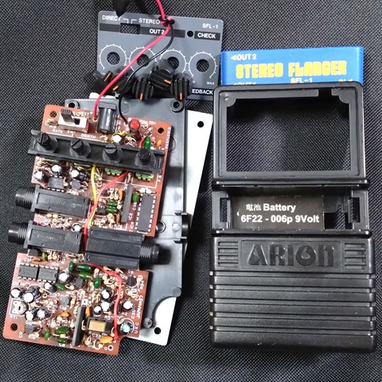
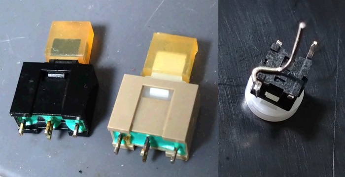
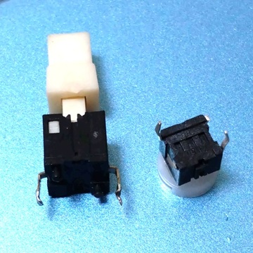
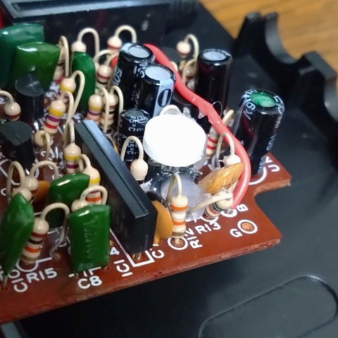
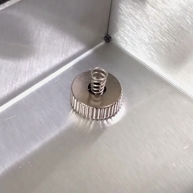
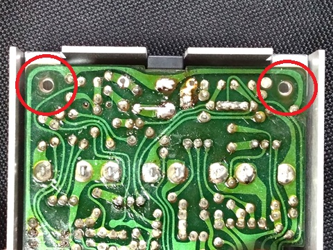
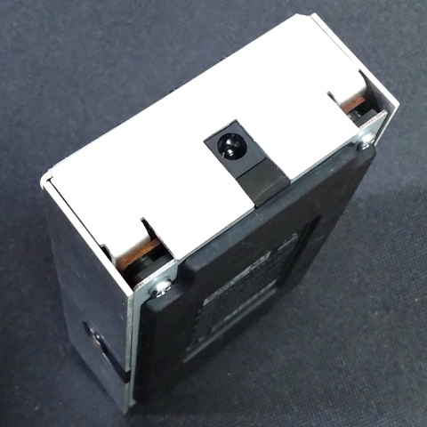
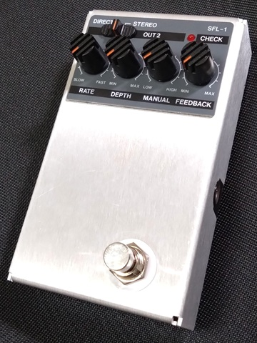

# ARIONエフェクター用アルミケース

ARIONエフェクターをリハウスする（中身を別のケースに移し替える）ための非公式アルミケースです。

### 別途必要なもの

- ARIONエフェクター（3ノブまたは4ノブのタイプ）

- M3ねじ 長さ15mm × 4本

- ばねが動くタイプのフットスイッチ（[PBS-24-MP](https://ja.aliexpress.com/item/33042857086.html)等）

- 基板上のスイッチ交換用スイッチ（[LED照光式タクトスイッチ](https://akizukidenshi.com/catalog/g/g113870/)等）

---

### リハウス手順

1. 分解

   本体の裏フタのねじを外します。ノブは引っ張ると外れます。パラメータ名が書いてあるパネルは両面テープで接着されているので、裏側から押すとはがせます。

    

   

2. 電池スナップ取り外し

   根本で切り取るか、はんだ付けを外します。

   

3. 基板上のスイッチ交換

   押す面が広いタイプのモーメンタリースイッチを使用します（→ [LED照光式タクトスイッチ](https://akizukidenshi.com/catalog/g/g113870/)等）。うまく基板の穴に適合するようにリード線の追加等の加工が必要です（LEDは不使用）。

   - 3点ではんだ付けされているタイプのスイッチ

      

   - 2点ではんだ付けされているタイプのスイッチ

      

   できるだけ基板と平行になるようにし、高さは9mm程度とします。接着剤で固定するのが望ましいです。

    

   

4. フットスイッチ取り付け

   ケース内側はワッシャー、ナットを付けません。

    

   

5. ねじ穴位置確認

   アルミケースのねじ穴が基板の穴と一致しているか確認します。ねじ穴がずれている場合、アルミケース側面の折り曲げ角度を調整してください。基板の穴を4mm径のドリルで広げるのも有効です。

    

   

6. ねじ取り付け

   基板、絶縁用のプラスチック板、底板を挟んでねじを取り付けます。ねじを軽く反時計回りに回し、ねじが落ち込む感触を確認してから時計回りに締め込みます。ねじ山は損傷しやすいため、ねじを強く締めすぎないようにしてください。

    

   

7. パネル・ノブ取り付け

   パネルを両面テープで貼り付け、ノブを取り付けて完成です。エフェクトオン・オフが切り替わらないときは、基板上のスイッチをうまく押せていない可能性があります。ケース内側のフットスイッチねじ部にワッシャーを追加して調整してください。

    

   

