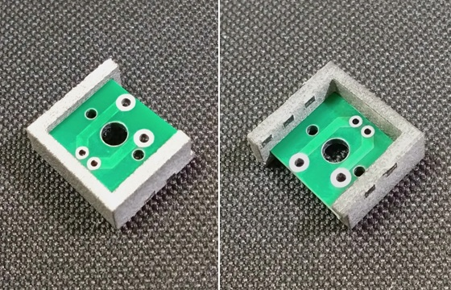
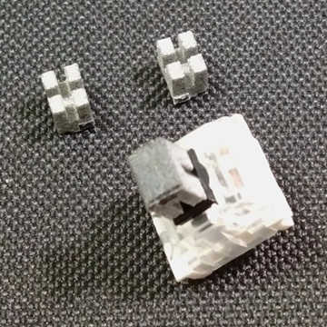
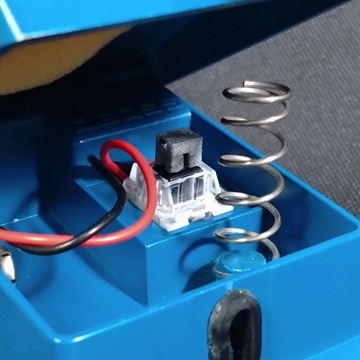
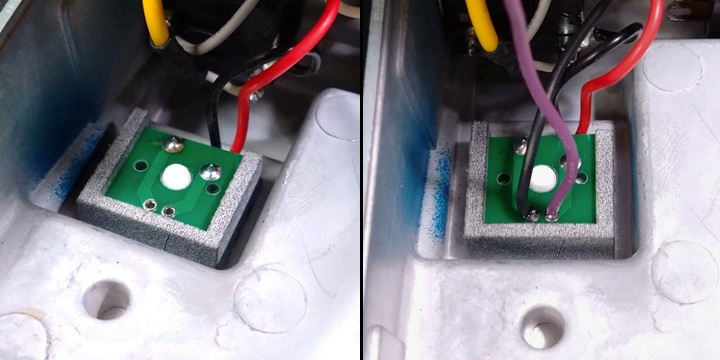

# BOSSエフェクター用スイッチセット

BOSSエフェクターのスイッチ交換用部品セットです。キーボード用のスイッチ（キースイッチ）を、3Dプリントパーツ（材質：PA12）と基板へのはんだ付けで固定します。

---

### 取り付け手順

1. 切り離し

   コの字型のパーツを切り離し、ニッパー等で余分な部分を切り取ります。向きに注意し、基板を溝に差し込みます。

    

   

2. キャップ取り付け

   キースイッチに取り付けるキャップは溝の幅が違う3種類があります。基本的には中央のものを使用してください。キャップのはまり方がきつすぎたり緩すぎたりする場合は、他のキャップに交換してください。

    

   

3. キースイッチ取り付け

   電池スナップを引き出した後、BOSSエフェクターにキースイッチをはめ込みます。

    

   

4. はんだ付け

   向きを確認してから、キースイッチのピンと配線をはんだ付けします。キースイッチを表側から押し付けた状態で行うのが望ましいです。多少ガタつきが出る場合があります。配線に左右の区別はないので、逆に取り付けても問題ありません。

    

